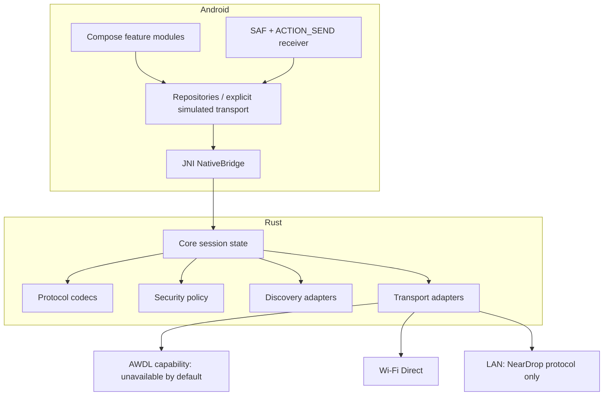

# Architecture

NearDrop separates Android presentation and OS integration from protocol/domain code. The initial app is a UI and sharing-intent scaffold; there is no production transport or AirDrop implementation.

## Decisions

- Kotlin + Compose provides Android-native UI, picker/share-sheet integration and lifecycle handling.
- Rust holds portable protocol parsing, session state, validation and transport traits. Direct JNI is selected for the first boundary because a narrow C/JNI API is explicit, has a small runtime footprint and avoids generating a broad binding layer before the API stabilizes. Use `jni` in the isolated `neardrop-ffi` crate; Kotlin calls typed native methods. Keep byte buffers bounded and never pass filesystem paths as trusted authority.
- Modules follow responsibility boundaries. Features do not own transport implementation; `data` provides repository adapters and an explicit test-only simulation.
- AWDL is capability-gated and cannot be selected unless a privileged platform adapter detects and verifies actual support.

## Runtime policy

All receive requests are pending until explicit accept/reject. The app should surface sender, names, sizes and total bytes before acceptance. Background receive uses a user-visible foreground service only while a transfer is active and where Android version policy requires it. Never show a fabricated peer as discovered.

## Compatibility claim gate

AirDrop compatibility requires two-way tests against stock Apple devices, no helper app on iOS, documented radio/OS versions, captured protocol evidence and security review. Passing a LAN or simulator test does not satisfy this gate.
