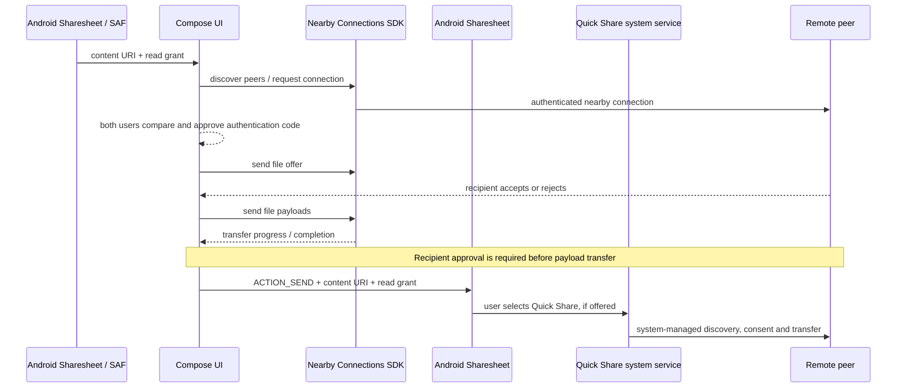

# Data flow

The Android NearDrop-to-NearDrop path uses `NearbyTransferManager`; it does not yet use the Rust core. The Android Sharesheet path is separate: Android/Quick Share controls discovery, transfer consent, progress and destination handling; NearDrop only grants selected content URIs to the system chooser. For inbound shares from other apps, NearDrop receives the shared URI and previews metadata. Quick Share's own peer receive path remains owned by the system app and normally saves into system storage rather than handing the transfer to NearDrop. Neither flow is AirDrop interoperability.

Incoming Nearby payloads are copied into Downloads/NearDrop after explicit consent and size validation. A user-selected SAF destination, background service, checksum verification, and Rust-core integration remain future work.
