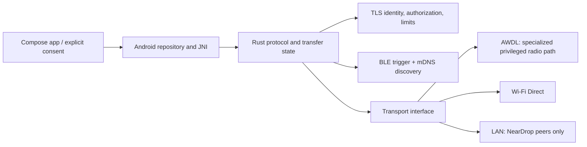

# Existing implementations and technical research

Research snapshot: 2026-11-09. Repository pages and project claims can change; status below reflects the linked sources checked on this date. A project claim is not treated as independent interoperability evidence.

## Findings

### Apple AirDrop

Apple's current Platform Security guide describes BLE discovery/wake-up and a peer-to-peer Wi-Fi link, with TLS protecting the subsequent communication; AirDrop's security section describes authentication and user acceptance. Apple's guide is security documentation, not a wire-protocol specification, and does not publish enough detail to implement a compatible peer. The support page and guide are linked under references. Independent protocol documentation adds AWDL, mDNS/Bonjour, IPv6 and the HTTP `/Discover`, `/Ask`, `/Upload` sequence, but those details should be treated as reverse-engineered, version-sensitive observations.

Relevant constraints: AirDrop is not ordinary LAN sharing; a LAN path does not make an Android device visible in Apple's native picker. BLE advertisement alone does not deliver file data. Contacts-only behavior depends on Apple identity/contact validation unavailable to an unaffiliated Android client. AirDrop's trust decision and explicit recipient acceptance must be preserved.

### OpenDrop (`seemoo-lab/opendrop`)

Python application implementing portions of AirDrop. Its documented stack depends on AWDL: macOS `awdl0` or Linux with OWL/another AWDL interface. It illustrates discovery, TLS/HTTP, plist and transfer flows. The project explicitly documents limitations including no equivalent Apple peer authentication/contact-record verification and automatic acceptance in the referenced version; multiple-file support is also limited. This is useful as protocol research only, not code to incorporate. It is GPL-3.0; copying/linking has copyleft implications. GitHub reports a latest release from 2021, so maintenance/activity should be rechecked before relying on it.

### OWL and OWLy

`seemoo-lab/owl` is a C AWDL implementation, separate from the AirDrop application protocol. Its GitHub page reports GPL-3.0 and an archived/read-only repository (archived 2026-10-12 in this snapshot). OWL has required a compatible Wi-Fi chipset/driver and privileged Linux setup; it is not a portable Android SDK transport.

`t4t5/owly` publishes an independent, detailed AirDrop protocol specification and Linux implementation. Its spec separates trigger (BLE), AWDL link, discovery (mDNS), TLS, HTTP, authentication/consent, data formats and archive transfer. It documents binary plist records, IPv6, `/Discover`, `/Ask`, `/Upload`, CPIO and DVZip, with observed quirks and security caveats. The document expressly says it is independent and not Apple-authored. The repository currently declares MIT and requires Rust 1.88; its hardware table and implementation target Linux Wi-Fi drivers, not Android. Treat it as a research reference subject to protocol/version drift. NearDrop copies none.

### AirDrop-for-Everything (`BenItBuhner/AirDrop-for-Everything`)

The repository currently presents a Rust workspace/core and platform shells. Its design separates a portable AirDrop protocol implementation (mDNS, TLS, HTTP, binary plist, DVZip and `newc` CPIO) from the link layer and front ends; a C ABI/JNI Android shell is described. It provides a useful modularity and test-organization reference. Its own platform matrix says Android has LAN plus BLE advertising but no AWDL, so Apple discovery/interoperability is unavailable there; LAN mode is for peer instances that support that path. The repository declares MIT, and its NOTICE credits prior work; inspect both before any reuse. This is not proof that its Android build interoperates with stock Apple devices.

### Tarish

Tarish's project site labels the project Apache-2.0 and describes a privileged Java Android system app and Rust daemons, Binder IPC, BLE and Wi-Fi Direct in the app, and mDNS/TLS/AirDrop handling in the daemon. It describes an AWDL implementation (`tarish-link`) plus a low-level radio HAL/netlink component. The stated target is integration into an OS image, with SELinux policy and a framework permission change; it is not a normal Play Store APK. The site's links to `tarish-app`, `tarish-daemon`, `tarish-link` and integration docs currently return GitHub 404 in this research environment, so no source tree or per-component license files could be inspected. The site reports hardware tests against Apple devices, including bidirectional AirDrop and measurements, but these remain project-published claims and have not been independently reproduced in this workspace.

The published hardware notes tie AWDL to Google's `wonder` shim/kernel-driver path and particular Broadcom/Qualcomm vendor images (examples include Pixel 10 variants); the site states devices without this support can provide Quick Share but not AWDL. It also reports Wi-Fi association loss while that AWDL path runs and Contacts Only limitations. This is the strongest current feasibility lead, but it does not establish universal Android support. Component licenses and source repositories must be audited individually before reuse; no Tarish code is included here.

### Bada and Mosey-Bada

The related `kyujin-cho/Bada` Android project implements Google's Quick Share interoperation without Play Services over LAN/Wi-Fi Direct and explicitly excludes AirDrop/AWDL/iPhone interop. It is a relevant Android sharing/service/UI reference but does not solve the AirDrop requirement. No license declaration was visible on the current repository page, so do not reuse its code until a license is verified.

### Mosey-Bada

An experimental KernelSU module for a OnePlus 15 path that bridges Android to `mosey_server`, with a Java shim/service and Rust daemon, Binder, BLE, raw mDNS and an HTTPS listener. Its repository describes Qualcomm `wonder.ko`/`wondertap`, NL80211 and privileged setup. It reports that daemon binaries must come from vendor images and describes Wi-Fi concurrency, SELinux and process-freezer constraints. GitHub marked the repo archived/read-only in this snapshot (2026-10-20). It has no visible license declaration on its repository page; treat it as all-rights-reserved unless a license file is verified. Reference only; not reusable code.

### Academic/security work

Stute et al. (USENIX Security 2019) analyze AWDL and AirDrop attack surfaces including discovery, synchronization, availability and driver interactions. Their work motivates careful state, privacy and radio-layer design; it does not turn an Android public API into AWDL.

Stute, Kreitschmann and Hollick, “One Billion Apples' Secret Sauce: Recipe for the Apple Wireless Direct Link Ad hoc Protocol,” ACM MobiCom 2018, DOI `10.1145/3241539.3241566`, reverse engineers AWDL operation and discusses coexistence/security implications. It is a foundational technical reference for link behavior, not an Android driver implementation.

Ebrahim and Tippenhauer, WOOT 2026, report protocol-aware research of AirDrop and Quick Share. Their abstract identifies complex pre-authentication binary/XML plist, CPIO and HTTP processing, and reports parser/router denial-of-service flaws. NearDrop uses this strictly to inform defensive limits, validation, fuzzing and state-machine tests; this project does not implement or reproduce exploits.

## Layer model and integration implications

NearDrop should implement the protocol and generic transport seams independently. AWDL must be a separately provisioned capability and report unavailable unless the exact device image/driver path has been verified. Android's public Wi-Fi Direct/LAN APIs cannot be relabeled as AWDL. A real AirDrop compatibility claim requires reproducible tests with unmodified Apple hardware and no companion iPhone app, recording device/OS/transport/security settings and both send directions.

## Integration assessment

| Source | Appropriate use | Reuse decision |
|---|---|---|
| Apple Platform Security | Security requirements and user-flow behavior | Documentation reference only |
| OpenDrop | Protocol study and historical behavior | Do not incorporate GPL code into this MIT starter |
| OWL | AWDL frame/link research | Reference only; GPL-3.0, archived, hardware-sensitive |
| OWLy SPEC | Independent protocol documentation | Read and cite; do not copy implementation |
| AirDrop-for-Everything | Rust module split, format/test ideas | Possible separately reviewed MIT dependency; none added |
| Tarish | Current system integration and hardware feasibility lead | Study source/build/licenses per component; not vendored |
| Mosey-Bada | Experimental privileged bridge constraints | Reference only; archived and no verified license |

## Open questions

1. Which exact SoCs, kernel builds, vendor images, regulatory domains and driver firmware support the needed monitor/injection/netlink path?
2. Can a distributable OS image expose that path with maintainable SELinux policy, and what framework modifications are required?
3. Which AirDrop versions accept anonymous/Everyone mode peers and which certificate/identity checks are mandatory for each flow?
4. What protocol changes have landed in current iOS/macOS releases versus the independent spec and observed captures?
5. Can both directions pass a repeatable stock-iPhone test without private Apple credentials or signing material?
6. What are the compatibility and privacy consequences of BLE identifiers, Contacts Only and rotating addresses?

## References checked

- [Apple Support: AirDrop security](https://support.apple.com/pt-br/guide/security/sec2261183f4/web)
- [Apple Platform Security guide, current PDF](https://help.apple.com/pdf/security/en_US/apple-platform-security-guide.pdf)
- [OpenDrop repository](https://github.com/seemoo-lab/opendrop)
- [OWL repository](https://github.com/seemoo-lab/owl)
- [OWLy independent AirDrop spec](https://github.com/t4t5/owly/blob/main/docs/SPEC.md)
- [AirDrop-for-Everything repository](https://github.com/benitbuhner/airdrop-for-everything)
- [Tarish architecture and compatibility notes](https://tarish.dev/)
- [Bada Android Quick Share implementation](https://github.com/kyujin-cho/Bada)
- [Mosey-Bada repository](https://github.com/FeelLiao/mosey-bada)
- [Stute et al., USENIX Security 2019 paper](https://www.usenix.org/system/files/sec19-stute.pdf) (direct PDF fetch unavailable during this run; publication metadata and related public preprint references were checked)
- [Stute et al., AWDL paper, DOI 10.1145/3241539.3241566](https://doi.org/10.1145/3241539.3241566)
- [Ebrahim & Tippenhauer, WOOT 2026](https://www.usenix.org/conference/woot26/presentation/ebrahim)
- [WOOT 2026 technical sessions and abstract](https://www.usenix.org/conference/woot26/technical-sessions)
